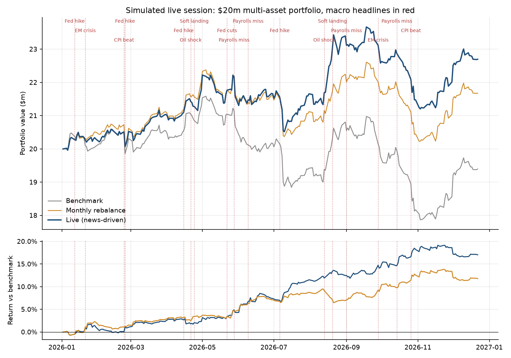
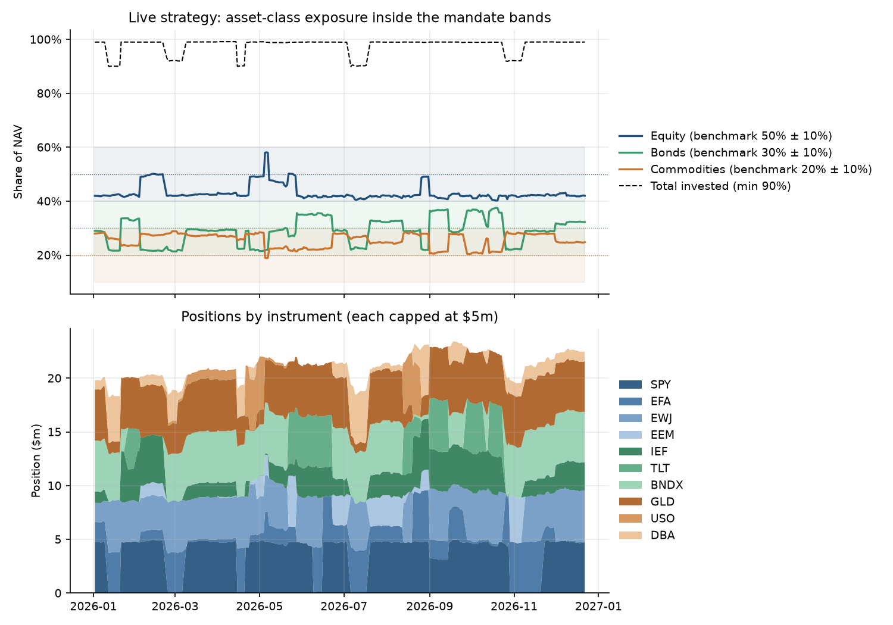
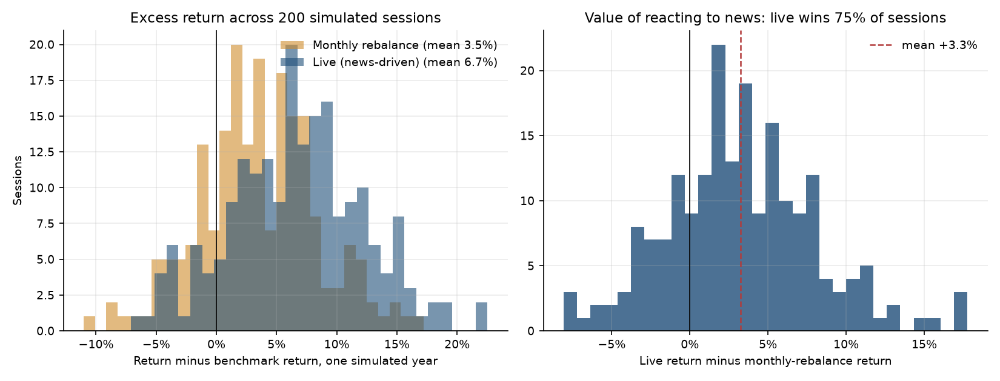

# Multi-Asset Portfolio Optimisation & Live Trade Execution

A Python system that runs a $20m multi-asset portfolio through a simulated live
market. The market is calibrated on ten years of real ETF prices, and macro headlines
arrive during the year. The portfolio is built by constrained mean-variance
optimisation, re-optimised as each headline lands, and traded through an execution
layer with spread and market-impact costs, a trade blotter, and daily mandate and
stop-loss checks.

The mandate follows the rules of a multi-asset trading simulation:

| Rule | Limit |
|---|---|
| Benchmark | 50% equity / 30% bonds / 20% commodities |
| Asset-class bands | Benchmark ± 10% |
| Single position | $5m maximum, long only |
| Invested | At least 90% of NAV |
| Stop-loss | Exit a position at a $500k unrealised loss, no re-entry for 10 days |

| Equity | Bonds | Commodities |
|---|---|---|
| SPY, EFA, EWJ, EEM | IEF, TLT, BNDX | GLD, USO, DBA |

## How it works

1. **Calibration.** Daily returns from Yahoo Finance (Jan 2016 – Dec 2025, 2,514 days)
   give the annualised covariance matrix and expected returns. Expected returns are shrunk
   halfway towards their cross-sectional mean, because ten years of data estimate them noisily.
2. **Live market.** Each session is one simulated trading year. Daily returns are
   multivariate Student-t (5 degrees of freedom, for fat tails) with the historical covariance.
   Each session draws its own true drift around the estimate, so the trader never knows it.
   About 12 headlines a year arrive at random, from a playbook of eight: Fed hike,
   Fed cuts, CPI beat, payrolls miss, soft landing, oil supply shock, EM crisis and BoJ shift.
   Each headline moves every instrument. Half of the move happens on the release day,
   before the trader can act. The rest drifts in over the next 10 days, with a lot of noise,
   and sometimes it reverses. Volatility runs at 1.5× for five days after each headline.
3. **Optimisation.** SciPy SLSQP maximises w'μ − (γ/2) w'Σw − c·Σ|Δw|, with
   long-only, position-cap, asset-class-band and invested constraints. The turnover
   penalty stops it trading on small changes in its inputs. It targets soft limits inside
   the hard ones ($4.75m per position, ±8% bands), so normal price moves don't push
   positions straight back over a limit. The covariance matrix updates every day by EWMA (λ = 0.97).
4. **Execution.** Orders fill at the close. The cost is half the bid-offer spread plus
   square-root market impact (0.1 × daily vol × √(order / average daily value)).
   Sells go first so buys are funded. The book tracks average entry prices, realised and
   unrealised P&L, and every trade with the reason it was made.
5. **Live loop.** At each close the trader checks the stop-losses, then the mandate, then
   the news. It re-optimises after a headline, using the playbook's average move as a view
   that fades over 10 days. It also re-optimises when that view runs out, every 21 days,
   after a stop-loss, and whenever a hard limit is breached.

Two strategies are compared with the benchmark, which holds 50/30/20 at no cost:

- **Monthly rebalance:** the same optimiser and risk controls, but ignores the news
- **Live (news-driven):** re-optimises as each headline arrives

## Example: oil supply shock

On 21 April in the featured session, the Suez Canal headline arrives. At the close the
trader buys $4.75m of USO (the soft cap). It sells EFA, since ex-US equity is the
most exposed to an oil shock. It also sells DBA and some gold, to keep commodities
inside their band. The proceeds go into SPY and IEF. The full sequence is in
`output/trade_blotter.csv` and `output/decision_log.csv`.

## Results

**Featured session** (seed 7, 17 headlines): the benchmark lost 3.0% over a rough year.

| | Live | Monthly rebalance | Benchmark |
|---|---|---|---|
| Return | **13.5%** | 8.4% | −3.0% |
| Volatility | 11.9% | 11.1% | 12.9% |
| Sharpe ratio | **1.13** | 0.78 | −0.17 |
| Beta vs benchmark | 0.83 | 0.80 | 1.00 |
| Max drawdown | 10.4% | 10.5% | 17.2% |
| Trades / costs | 343 / $133k | 153 / $26k | |
| Stop-losses hit | 3 | 4 | |
| Days ending in breach | **0** | **0** | |





**Monte Carlo: averages over 200 sessions**

| | Live | Monthly rebalance | Benchmark |
|---|---|---|---|
| Return | **10.2%** | 6.9% | 3.4% |
| Volatility | 10.6% | 10.0% | 11.5% |
| Sharpe ratio | **0.91** | 0.68 | 0.28 |
| Information ratio | **1.28** | 0.75 | |
| Max drawdown | 9.1% | 9.2% | 12.1% |
| Trading costs | $82k | $18k | |

Reacting to news added 3.3% a year over monthly rebalancing on average, and won in 75%
of sessions, for about $64k more in trading costs. The spread is wide, with a standard
deviation of 4.8%, so one year proves very little either way. Both optimised strategies
also beat the benchmark through lower equity beta (about 0.8). The headline set leans
negative for risk assets, which helps them.



**Where the edge comes from.** The live strategy can only gain from the drift that follows a
headline. When that drift is switched off (`--follow-through 0`), it does 0.6% a year *worse*
than monthly rebalancing and wins only 44% of sessions: it pays for extra trades and gets
nothing back. Trading on news only works if markets are slow to price it in.

## Limitations

- The headline playbook is hand-built, and the trader knows its average effect, though not the size of each headline.
- Fills are at the daily close. There's no intraday path, no order book, and no partial fills.
- Expected returns come from history, which is a poor guide to the future, and the strategy depends on them.

## Run

```bash
python3 -m venv .venv && .venv/bin/pip install -r requirements.txt
.venv/bin/python run.py
.venv/bin/python -m pytest
```

Options: `--seed` (featured session), `--sessions` (Monte Carlo size, 0 to skip),
`--follow-through`, `--confidence` (weight on the news view), `--risk-aversion`,
`--start`, `--end`, `--out`, and `--source synthetic` (runs offline; the pipeline also falls back
to it if the download fails). A full run with 200 sessions takes about 5 minutes.

Output in `output/`: `trade_blotter.csv`, `decision_log.csv` (each re-optimisation, its trigger and
target weights), `nav.csv`, `live_weights.csv`, `session_events.csv`, `session_summary.csv`,
`monte_carlo.csv` and the three charts.

## Files

- `config.py`: instruments, mandate limits, trading costs and the macro headline playbook
- `data.py`: price loading (yfinance) and synthetic fallback
- `market.py`: calibration and the simulated live market
- `optimiser.py`: constrained mean-variance optimiser, EWMA covariance, mandate checks
- `execution.py`: order execution, costs, position keeping and the trade blotter
- `trader.py`: the day-by-day trading loop for each strategy
- `metrics.py`: return, risk and benchmark-relative statistics
- `plots.py`: Matplotlib charts
- `run.py`: command-line runner
- `tests/test_trading.py`: pytest checks of the optimiser constraints, trade accounting, costs and mandate compliance
